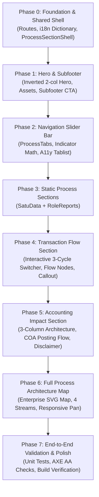

# PRD: Connected Process (`connected-process`) — Architecture, Specifications & Sequential Implementation Plan

---

## 1. Executive Summary & Page Context

### 1.1 Page Purpose & Value Proposition
The **Connected Process** page (`/connected-process`) is a dedicated high-intent product showcase for **SOFICloud ERP**. Where the existing `business-realtime` page demonstrates real-time monitoring dashboards, the `connected-process` page focuses on **cross-functional process continuity, automated accounting impact, and unified enterprise data flow**:

> **"Dari Aktivitas Bisnis Hingga Laporan Keuangan"**  
> *"From Business Activities to Financial Statements"*  
> *"Penjualan, pengadaan, kebutuhan material, progres pesanan, dan keuangan dapat dilihat dari dashboard SOFICloud. Setiap tampilan membantu tim melihat kondisi terkini dan menentukan hal yang perlu ditindaklanjuti."*

### 1.2 Core Target Audiences & Key Takeaways
- **CFOs & Accounting Leaders:** Seeing operations automatically feed journals, general ledger, trial balance, and financial statements without manual double-entry or reconciliation headaches.
- **Operations Directors & Plant Managers:** Ensuring context, procurement demands, bill of materials, and delivery milestones travel seamlessly across departments with built-in audit trails and approvals.
- **Business Owners & CEOs:** Having a single, reliable source of truth where operational activities translate directly to financial results and actionable management metrics.

---

## 2. Comparative Architecture: `business-realtime` vs `connected-process`

| Architectural Dimension | `business-realtime` (Existing Reference) | `connected-process` (This Specification) |
| :--- | :--- | :--- |
| **Page Theme** | Real-time Dashboard Monitoring & KPI Visibility | Integrated Transactional Workflows, Data Continuity & Accounting Impact |
| **Hero Layout** | Text on Left (col-span-6), Tablet on Right (col-span-6) | **Inverted Layout**: Tablet Visual on Left (col-span-6), Copy & Headline on Right (col-span-6) |
| **Hero Visual** | Tablet showing KPI dashboards and metrics | Tablet showing Connected Business ERP modules (`02 Procurement`, `03 Inventory`, `04 Manufacturing`, `05 Project & Cost`), connected transactions bar, and audit trail |
| **Navigation Slider Bar** | 5 functional dashboards: `SALES PERFORMANCE`, `PROCUREMENT CONTROL`, `MATERIAL READINESS`, `ORDER PIPELINE`, `FINANCIAL VISIBILITY` | **5 process milestones**: `SATU DATA`, `ALUR TRANSAKSI`, `DAMPAK AKUNTANSI`, `LAPORAN`, `PETA LENGKAP` |
| **Section Architecture** | `visibility-section-shell` hosting `erp-window-chrome` with simulated analytics/bar charts/tables + decision card | `process-section-shell` hosting **dynamic workflow diagrams, multi-stage pipelines, interactive cycle switchers**, and stakeholder report cards |
| **Interactivity Depth** | Tab navigation slider, static mockups with tooltips | Interactive 3-way transaction cycle switcher (Order-to-Cash, Procure-to-Pay, Plan-to-Produce) + complex enterprise process SVG network map |
| **Thematic Colors** | Gradients (`#F9CEC8`, `#DEF2EB`, `#E8F0FC`, etc.) | Semantic thematic stages: Light Blue (`#E8F0FC`), Sage/Cyan (`#D6E6E3`), Periwinkle (`#EBF2FD`), Warm Coral (`#FDE8E4`), Forest Mint (`#DDEAE6`) |

```mermaid
flowchart TD
    subgraph Page["ConnectedProcess Page (/connected-process)"]
        Hero["1. ConnectedProcessHero\n(Inverted: Tablet Left, Headline Right)"]
        Nav["2. ProcessTabs Slider Bar\n(Sticky / Anchored Tab Navigation)"]
        
        subgraph Sections["src/app/components/connected-process/sections/"]
            S1["3. SatuData Section\n('Setiap Bagian Bergerak Dengan Konteks Yang Sama')"]
            S2["4. TransactionFlow Section\n(Interactive 3-Cycle Stepper: O2C, P2P, Plan-to-Produce)"]
            S3["5. AccountingImpact Section\n(Dokumen Sumber -> Posting COA -> Hasil Keuangan)"]
            S4["6. RoleReports Section\n(3 Perspectives: Operasional, Keuangan, Manajemen)"]
            S5["7. FullProcessMap Section\n(Comprehensive 4-Stream ERP Architecture Map)"]
        end
        
        Subfooter["8. ConnectedProcessSubfooter\n('Sambungkan Proses Pahami Hasilnya')"]
        GlobalFooter["Global Application Footer"]
    end

    Hero --> Nav
    Nav --> S1 --> S2 --> S3 --> S4 --> S5
    S5 --> Subfooter --> GlobalFooter
```



---

## 3. Detailed Component Specifications

### 3.1 Hero Section (`ConnectedProcessHero`)
- **Directory:** `src/app/components/connected-process/hero/`
- **Container Styling:** Rounded card (`rounded-3xl sm:rounded-4xl lg:rounded-[36px]`) with soft conic/radial background gradient matching `business-realtime/hero`.
- **Inverted 2-Column Grid Layout:**
  - **Left Column (Visual Asset):**
    - 3D pedestal with tablet mockup resting on top.
    - Tablet UI displays:
      - Header: "CONNECTED BUSINESS" with user avatar "A" and date "28-07".
      - Modules row: `02 Procurement (PR - PO - GRN)`, `03 Inventory (Stock - Movement)`, `04 Manufacturing (BOM - MO - Cost)`, `05 Project & Cost (Budget - Actual)`.
      - Connected Transactions banner: `... -> Journal -> General Ledger ↗`.
      - Operations summary & bottom status: `AUDIT & APPROVAL | AUDIT TRAIL | BUSINESS ANALYTICS`.
  - **Right Column (Copy & Value Proposition):**
    - Headline (`<h1>`, `Inter Variable`, font-weight 800):
      ```
      Dari Aktivitas Bisnis
      Hingga Laporan Keuangan
      ```
    - Subtitle (`<p>`, `DM Sans Variable`, font-weight 400, color `#23244E`):
      > *"Penjualan, pengadaan, kebutuhan material, progres pesanan, dan keuangan dapat dilihat dari dashboard SOFICloud. Setiap tampilan membantu tim melihat kondisi terkini dan menentukan hal yang perlu ditindaklanjuti."*

---

### 3.2 Navigation Slider Bar (`ProcessTabs`)
- **Directory:** `src/app/components/connected-process/process-tabs/`
- **Pattern Reference:** `VisibilityFunction` from `business-realtime`.
- **Tabs (5 Milestones):**
  1. `SATU DATA` (`#satu-data`)
  2. `ALUR TRANSAKSI` (`#alur-transaksi`)
  3. `DAMPAK AKUNTANSI` (`#dampak-akuntansi`)
  4. `LAPORAN` (`#laporan`)
  5. `PETA LENGKAP` (`#peta-lengkap`)
- **Interactive Slider Indicator:**
  - Absolute positioned blue indicator bar (`#365AD2`, height `3px`, rounded corners).
  - Dynamically calculates `indicatorLeft` and `indicatorWidth` signals based on the active tab DOM element bounding box.
  - Updates on click, window resize, and scroll-spy triggers.
- **Accessibility:**
  - Keyboard navigation (`ArrowRight`, `ArrowLeft`, `Home`, `End`) with roving tabindex.
  - ARIA attributes: `role="tablist"`, `role="tab"`, `aria-selected`, `aria-controls`.

---

### 3.3 Shared Presentation Shell (`ProcessSectionShell`)
- **Directory:** `src/app/components/connected-process/process-section-shell/`
- **Pattern Reference:** `VisibilitySectionShell` from `business-realtime`.
- **Visual Structure:**
  - Outer container: `w-full max-w-7xl mx-auto px-4 sm:px-6 lg:px-8 py-5 sm:py-7 lg:py-8`.
  - Card shell: `rounded-3xl bg-white shadow-[0_8px_30px_rgba(35,36,78,0.08)] overflow-hidden border border-gray-100/70`.
  - Header area: Centered title (`h2`), centered blue accent line (`h-0.5 bg-[#365AD2] max-w-214 mx-auto my-4`), and centered description.
  - Stage wrapper: Configurable background class (`stageBgClass`, e.g. `bg-[#E8F0FC]`, `bg-[#D6E6E3]`, etc.) containing projected content (`<ng-content />`).

---

### 3.4 Section 1: "SATU DATA" (`SatuDataSection`)
- **Directory:** `src/app/components/connected-process/sections/satu-data/`
- **Anchor ID:** `#satu-data`
- **Header:**
  - **Title:** *"Setiap Bagian Bergerak Dengan Konteks Yang Sama."*
  - **Description:** *"Dokumen bisnis membawa referensi ke tahap berikutnya. Tim dapat mengikuti asal permintaan, status pesanan, penerimaan, produksi, penagihan, hingga transaksi keuangannya."*
- **Stage (Background: Soft Blue `#E8F0FC`):**
  - Grid of 3 white cards (`rounded-2xl`, p-6 sm:p-8, shadow):
    - **Card 01:**
      - Number: `01` (bold navy `#23244E`).
      - Title: *"Referensi dokumen terhubung"*
      - Description: *"Order, PO, penerimaan, invoice, dan pembayaran dapat ditelusuri sesuai alurnya."*
    - **Card 02:**
      - Number: `02`
      - Title: *"Kontrol lintas bagian"*
      - Description: *"Workflow dan approval memberi titik pemeriksaan saat dokumen berpindah proses."*
    - **Card 03:**
      - Number: `03`
      - Title: *"Angka yang dapat dijelaskan"*
      - Description: *"Laporan operasional dan akuntansi memiliki transaksi sumber yang jelas."*

---

### 3.5 Section 2: "ALUR TRANSAKSI" (`TransactionFlowSection`)
- **Directory:** `src/app/components/connected-process/sections/transaction-flow/`
- **Anchor ID:** `#alur-transaksi`
- **Header:**
  - **Title:** *"Tiga Alur Satu Sistem Yang Terhubung"*
  - **Description:** *"Pilih contoh transaksi untuk melihat bagaimana modul saling meneruskan informasi. Setiap tahap memiliki dokumen dan tujuan yang berbeda."*
- **Interactive 3-Cycle Switcher:**
  - Pill tabs allowing user selection:
    1. **Order-to-Cash** (Active by default): Subtitle *"Penjualan hingga penerimaan"*
    2. **Procure-to-Pay**: Subtitle *"Kebutuhan hingga pembayaran"*
    3. **Plan-to-Produce**: Subtitle *"Material hingga biaya produksi"*
- **Stage (Background: Soft Sage/Mint `#D6E6E3`):**
  - **Order-to-Cash Sequence Nodes (connected by horizontal blue line):**
    1. `Sales Quotation` (Icon: Quotes `...`) — *"Penawaran ke pelanggan"*
    2. `Sales Order` (Icon: Basket) — *"Pesanan terkonfirmasi"*
    3. `Delivery Order` (Icon: Truck) — *"Barang diserahkan"*
    4. `Customer Invoice` (Icon: Document with Coin) — *"Piutang terbentuk"*
    5. `Receipt` (Icon: Receipt Badge) — *"Pembayaran diterima"*
  - **Procure-to-Pay Sequence Nodes:**
    1. `Purchase Requisition` — *"Permintaan kebutuhan"*
    2. `Purchase Order` — *"Pesanan pemasok"*
    3. `Goods Receipt` — *"Penerimaan barang"*
    4. `Supplier Invoice` — *"Tagihan masuk"*
    5. `Payment` — *"Pelunasan pembayaran"*
  - **Plan-to-Produce Sequence Nodes:**
    1. `BOM & Routing` — *"Standar komponen & jalur"*
    2. `Production Planning` — *"Jadwal & alokasi"*
    3. `Manufacturing Order` — *"Surat perintah kerja"*
    4. `Manufacturing Process` — *"Pencatatan aktual"*
    5. `Standard Costing & Variance` — *"Kalkulasi harga pokok"*
  - **Bottom Callout Banner (White Card inside Stage):**
    - Left side: Bold blue title `TERLIHAT DI LAPORAN` with context tags: `Sales pipeline · Delivery · A/R aging · Cash receipt`.
    - Right side (separated by vertical line): Explanatory note:
      > *"Dampak jurnal mengikuti transaksi yang diposting dan pengaturan akun perusahaan; Sales Quotation dan Sales Order belum otomatis menjadi pendapatan."*

---

### 3.6 Section 3: "DAMPAK AKUNTANSI" (`AccountingImpactSection`)
- **Directory:** `src/app/components/connected-process/sections/accounting-impact/`
- **Anchor ID:** `#dampak-akuntansi`
- **Header:**
  - **Title:** *"Operasional Berjalan Pembukuan Mengikuti"*
  - **Description:** *"Dokumen yang sudah memenuhi tahap pencatatan menghasilkan dampak akuntansi berdasarkan konfigurasi akun dan kebijakan perusahaan."*
- **Stage (Background: Soft Periwinkle `#EBF2FD`):**
  - 3-column architectural pipeline connected by prominent directional arrows `→`:
    - **Column 1: "Dokumen Sumber"**
      - Subtitle: *"Termasuk General Journal dan adjustment bila diperlukan"*
      - 4 white pill badges with icons:
        1. `Customer Invoice`
        2. `Supplier Invoice`
        3. `Inventory & Manufacturing`
        4. `Receipt & Payment`
    - **Directional Arrow `→`**
    - **Column 2: "Posting & Pemetaan COA"**
      - Subtitle: *"Transaksi dapat ditelusuri kembali ke dokumen asal. Koreksi dilakukan melalui proses yang sesuai, dengan jejak perubahan dan otorisasi."*
      - Vertical process column:
        - Box: `Jurnal`
        - Arrow down `↓`
        - Box: `Trial Balance`
        - Arrow down `↓`
        - Box: `General Ledger`
    - **Directional Arrow `→`**
    - **Column 3: "Hasil Keuangan"**
      - Subtitle: *"Kinerja keuangan positif melalui pertumbuhan pendapatan dan efisiensi biaya."*
      - 4 white pill badges with icons:
        1. [Bar Chart Icon] `Laba Rugi`
        2. [Sheet Icon] `Neraca`
        3. [Coins Icon] `Arus Kas`
        4. [Ledger Icon] `Subledger AP / AR`
  - **Bottom Policy Disclaimer Box:**
    > **Penting:** *Alur ini menggambarkan hubungan proses dan data. Jenis jurnal, titik posting, pengakuan pendapatan/biaya, serta format laporan disesuaikan dengan implementasi dan kebijakan akuntansi perusahaan.*

---

### 3.7 Section 4: "LAPORAN" (`RoleReportsSection`)
- **Directory:** `src/app/components/connected-process/sections/role-reports/`
- **Anchor ID:** `#laporan`
- **Header:**
  - **Title:** *"Laporan Untuk Setiap Tim Dalam Satu Alur Data"*
  - **Description:** *"Management melihat hasil akhir sekaligus konteks operasional yang membentuknya."*
- **Stage (Background: Soft Warm Peach `#FDE8E4`):**
  - Grid of 3 stakeholder tier cards:
    - **Card 01: OPERASIONAL ("Sedang Bergerak")**
      - Accent Stripe: Light Sky Blue (`#70A5F9`).
      - Copy: *"Open order, outstanding procurement, penerimaan barang, posisi stok, kebutuhan material, progress produksi, dan status project."*
      - Tags: `· Sales`, `· Procurement`, `· Inventory`, `· Production`.
    - **Card 02: KEUANGAN ("Sudah Tercatat")**
      - Accent Stripe: Coral/Salmon (`#FA9E88`).
      - Copy: *"Piutang, utang, kas dan bank, General Ledger, Balance, Laba Rugi, Neraca, serta laporan arus kas."*
      - Tags: `· AR`, `· AP`, `· Cash & Bank`, `· Accounting`.
    - **Card 03: MANAJEMEN ("Perlu Diputuskan")**
      - Accent Stripe: Mint/Teal (`#48C6B6`).
      - Copy: *"Dashboard dan analisis membantu membaca tren penjualan, biaya produksi, budget versus actual project, serta transaksi yang membutuhkan perhatian."*
      - Tags: `· Dashboard`, `· Analytics`, `· Project`, `· Control`.

---

### 3.8 Section 5: "PETA LENGKAP" (`FullProcessMapSection`)
- **Directory:** `src/app/components/connected-process/sections/full-process-map/`
- **Anchor ID:** `#peta-lengkap`
- **Header:**
  - **Title:** *"Lihat Hubungan Proses Lebih Lengkap"*
  - **Description:** *"Diagram ini merangkum alur pembelian, produksi, penjualan, General Ledger, dan keluaran laporan sebagai referensi kemampuan produk."*
- **Stage (Background: Light Sage Mint `#DDEAE6`):**
  - Interactive enterprise architectural map orchestrating 4 key process streams into the General Ledger:
    1. **Purchasing & AP Stream (Blue):**
       - `Purchase Requisition` → `Purchase Quotation` → `Purchase Order` → `Goods Receipt` → `Supplier Invoice` → `Payment`.
       - Branches: `Purchase Return`, `A/P Debit Note`, `A/P Statement`.
    2. **Manufacturing & Costing Stream (Teal/Green):**
       - `Bill Of Material & Routing`, `Planning`, `Manufacturing Order`, `Manufacturing Process`, `Standard Costing & Variance` → `Manufacturing` hub.
    3. **Sales & AR Stream (Red/Coral):**
       - `Sales Quotation` → `Sales Order` → `Packing List & Delivery Order` → `Customer Invoice` → `Receive`.
       - Branches: `Return`, `A/R Credit Note`, `A/R Statement`.
    4. **General Ledger & Financial Output Hub (Center/Right):**
       - Integration links: `Manufacturing` ↔ `General Ledger`, `Goods Receipt`/`Supplier Invoice` → `General Ledger`, `Customer Invoice`/`Receive` → `General Ledger`.
       - Adjustments: `General Journal`, `Adjustment` → `General Ledger`.
       - Financial cascade: `General Ledger` → `Trial Balance` → `COGS`, `Profit Loss`, `Balance Sheet`, `Cash Flow`.
  - **Responsive Strategy:**
    - Desktop: Full wide layout with SVG connectors.
    - Tablet / Mobile: Smooth horizontal panning container with scrollbar and visual drag hint.

---

### 3.9 Subfooter Section (`ConnectedProcessSubfooter`)
- **Directory:** `src/app/components/connected-process/subfooter/`
- **Visual Design:** Clean white centered layout matching `business-realtime/subfooter`.
- **Title:** *"Sambungkan Proses Pahami Hasilnya"*
- **Description:** *"Diskusikan alur transaksi, titik kontrol, dan kebutuhan pelaporan perusahaan Anda bersama tim SOFICloud."*

---

## 4. Sequential Phases of Implementation

Following the codebase philosophy demonstrated in `PRD-visibility-sections.md`, we roll out the page **step-by-step with strict verification gates**.



---

### Phase 0: Foundation Setup & Shared Shell
*Objective: Prepare the routing, translation keys, page shell, and reusable section wrapper before building individual domain sections.*

- [ ] **Step 0.1 — Internationalization Dictionary Setup (`public/i18n/*.json`):**
  - Add `CONNECTED_PROCESS` namespace to all 5 language files (`id.json`, `en.json`, `ja.json`, `ko.json`, `zh.json`).
  - Provide complete Indonesian strings from Figma screenshots and corresponding professional English translations.
- [ ] **Step 0.2 — Configure Application Routing:**
  - Add lazy-loaded route in `src/app/systems/routes/app.routes.ts`:
    ```typescript
    {
      path: 'connected-process',
      loadComponent: () =>
        import('../../pages/connected-process/connected-process').then(
          (m) => m.ConnectedProcess
        ),
    }
    ```
- [ ] **Step 0.3 — Scaffold Page Component (`src/app/pages/connected-process/`):**
  - Create `connected-process.ts`, `connected-process.html`, `connected-process.spec.ts`.
  - Implement browser check and scroll-to-top on mount.
- [ ] **Step 0.4 — Build Reusable `ProcessSectionShell` Component (`src/app/components/connected-process/process-section-shell/`):**
  - Create `process-section-shell.ts`, `process-section-shell.html`, `process-section-shell.spec.ts`.
  - Inputs using signal inputs: `sectionId = input.required<string>()`, `title = input.required<string>()`, `description = input.required<string>()`, `stageBgClass = input<string>('bg-[#E8F0FC]')`.
  - Include `<ng-content />` projection for domain content.
- [ ] **Verification Gate 0:** Route `/connected-process` loads cleanly without errors; `ProcessSectionShell` renders projected content in test runner.

---

### Phase 1: Hero & Subfooter Sections
*Objective: Implement the top hero card and bottom subfooter to establish the visual framing of the page.*

- [ ] **Step 1.1 — Asset Placement:**
  - Place tablet graphic and pedestal SVG into `public/images/connected-process/`.
- [ ] **Step 1.2 — Build `ConnectedProcessHero` Component (`src/app/components/connected-process/hero/`):**
  - Create `hero.ts`, `hero.html`, `hero.spec.ts`.
  - Implement inverted 2-column layout (Tablet illustration on Left, Headline & copy on Right).
  - Use `NgOptimizedImage` for image assets with `priority` attribute.
- [ ] **Step 1.3 — Build `ConnectedProcessSubfooter` Component (`src/app/components/connected-process/subfooter/`):**
  - Create `subfooter.ts`, `subfooter.html`, `subfooter.spec.ts`.
  - Centered typography matching design system.
- [ ] **Step 1.4 — Mount into Page:**
  - Import `<app-hero />` and `<app-subfooter />` into `connected-process.html`.
- [ ] **Verification Gate 1:** Hero displays inverted layout smoothly across all breakpoints (desktop 2-col, mobile stacked); Subfooter renders preceding global footer.

---

### Phase 2: Navigation Slider Bar (`ProcessTabs`)
*Objective: Build the 5-tab sticky/anchored navigation bar with the animated blue indicator slider.*

- [x] **Step 2.1 — Scaffold `ProcessTabs` Component (`src/app/components/connected-process/process-tabs/`):**
  - Create `process-tabs.ts`, `process-tabs.html`, `process-tabs.spec.ts`.
  - Declare the 5 tabs: `satu-data`, `alur-transaksi`, `dampak-akuntansi`, `laporan`, `peta-lengkap`.
- [x] **Step 2.2 — Implement Dynamic Indicator Math:**
  - Calculate `indicatorLeft` and `indicatorWidth` signals from `getBoundingClientRect()`.
  - Handle window resize and initial load timing (`AfterViewInit`).
- [x] **Step 2.3 — Implement WAI-ARIA & Keyboard Controls:**
  - Roving tabindex, arrow key listeners (`ArrowLeft`/`ArrowRight`/`Home`/`End`).
  - Anchor click smooth-scrolling to section target IDs.
- [x] **Step 2.4 — Mount into Page:**
  - Place `<app-process-tabs />` immediately below `<app-hero />`.
- [x] **Verification Gate 2:** Indicator slides smoothly to clicked tabs; arrow keys navigate tabs properly; no console errors or hydration mismatches.

---

### Phase 3: Static Showcase Sections (`SatuData` & `RoleReports`)
*Objective: Build the two modular 3-card sections that present structured content without complex interactive logic.*

- [ ] **Step 3.1 — Build `SatuDataSection` (`src/app/components/connected-process/sections/satu-data/`):**
  - Wrap in `<app-process-section-shell sectionId="satu-data" stageBgClass="bg-[#E8F0FC]" ...>`.
  - Implement 3 feature cards (01 Referensi Dokumen, 02 Kontrol Lintas Bagian, 03 Angka Yang Dapat Dijelaskan).
- [ ] **Step 3.2 — Build `RoleReportsSection` (`src/app/components/connected-process/sections/role-reports/`):**
  - Wrap in `<app-process-section-shell sectionId="laporan" stageBgClass="bg-[#FDE8E4]" ...>`.
  - Implement 3 stakeholder tier cards (Operasional, Keuangan, Manajemen) with accent color stripes and department tags.
- [ ] **Step 3.3 — Mount & Verify:**
  - Register `<app-satu-data />` and `<app-role-reports />` in `connected-process.html`.
- [ ] **Verification Gate 3:** Both sections render pixel-perfect cards with accurate typography, padding, and responsive grid wrapping.

---

### Phase 4: Transaction Flow Section (`TransactionFlow`)
*Objective: Deliver the interactive 3-cycle workflow pipeline (Order-to-Cash, Procure-to-Pay, Plan-to-Produce).*

- [ ] **Step 4.1 — Scaffold Component & State:**
  - Create `src/app/components/connected-process/sections/transaction-flow/`.
  - Define `selectedCycle = signal<'O2C' | 'P2P' | 'P2PR'>('O2C')`.
  - Derive current steps and report metadata via `computed()`.
- [ ] **Step 4.2 — Build Cycle Switcher Tabs:**
  - Interactive pill selector with active elevation and subtle border.
- [ ] **Step 4.3 — Build Document Pipeline Stepper Nodes:**
  - Visual nodes with custom icons, active blue connecting bar, and document captions.
  - Smooth animated transition when switching cycles.
- [ ] **Step 4.4 — Build Bottom Report Summary Callout:**
  - Two-column callout banner with `TERLIHAT DI LAPORAN` tags and accounting posting disclaimer.
- [ ] **Step 4.5 — Mount into Page:**
  - Add `<app-transaction-flow />` directly below `SatuData`.
- [ ] **Verification Gate 4:** Switching between Order-to-Cash, Procure-to-Pay, and Plan-to-Produce instantaneously updates document nodes and report callout without layout jumps.

---

### Phase 5: Accounting Impact Section (`AccountingImpact`)
*Objective: Build the 3-column operational-to-ledger architecture pipeline.*

- [ ] **Step 5.1 — Scaffold Component:**
  - Create `src/app/components/connected-process/sections/accounting-impact/`.
  - Wrap in `<app-process-section-shell sectionId="dampak-akuntansi" stageBgClass="bg-[#EBF2FD]" ...>`.
- [ ] **Step 5.2 — Implement 3-Column Architectural Flow:**
  - Column 1: Dokumen Sumber (4 source document cards).
  - Arrow 1: Prominent directional blue connector.
  - Column 2: Posting & Pemetaan COA (Vertical flow: Jurnal → Trial Balance → General Ledger).
  - Arrow 2: Prominent directional blue connector.
  - Column 3: Hasil Keuangan (4 financial statement cards with icons).
- [ ] **Step 5.3 — Implement Policy Callout Box:**
  - Bottom disclaimer banner regarding accounting configuration and company policies.
- [ ] **Step 5.4 — Mount into Page:**
  - Add `<app-accounting-impact />` in `connected-process.html`.
- [ ] **Verification Gate 5:** Pipeline layout aligns cleanly on desktop; stacks gracefully on mobile with clear directional sequence.

---

### Phase 6: Full Process Architecture Map (`FullProcessMap`)
*Objective: Build the comprehensive 4-stream ERP process and data interaction map.*

- [ ] **Step 6.1 — Scaffold Component:**
  - Create `src/app/components/connected-process/sections/full-process-map/`.
  - Wrap in `<app-process-section-shell sectionId="peta-lengkap" stageBgClass="bg-[#DDEAE6]" ...>`.
- [ ] **Step 6.2 — Implement 4-Stream Interconnected Diagram:**
  - Purchasing Stream (Blue nodes + branches).
  - Manufacturing Stream (Teal/green nodes + manufacturing hub).
  - Sales Stream (Red/coral nodes + branches).
  - Central General Ledger Hub & Downstream Financial Statements (Center core).
- [ ] **Step 6.3 — Responsive Viewport Strategy:**
  - Desktop: Full wide layout with SVG connector paths.
  - Mobile/Tablet: Overflow-x container with smooth drag scrolling and visual scroll indicator.
- [ ] **Step 6.4 — Mount into Page:**
  - Add `<app-full-process-map />` as the final milestone section.
- [ ] **Verification Gate 6:** All diagram labels are razor-sharp, connections reflect the architectural map, and horizontal scrolling works smoothly on touch devices.

---

### Phase 7: End-to-End Validation, Accessibility & Build Verification
*Objective: Rigorous quality assurance, accessibility audits, and production build checks.*

- [ ] **Step 7.1 — Unit Test Coverage:**
  - Run `npm test` or component spec suite for all newly created components.
- [ ] **Step 7.2 — Accessibility (WCAG 2.1 AA & AXE):**
  - Verify contrast ratios on all tinted stages.
  - Verify ARIA tab controls and keyboard roving focus.
- [ ] **Step 7.3 — Translation Completeness:**
  - Verify all 5 locale files contain identical key schemas without missing values.
- [ ] **Step 7.4 — Production Build:**
  - Run `npm run build` to ensure zero compilation or SSR errors.

---

## 5. Technical Guardrails & Coding Standards (per `AGENTS.md`)

1. **Angular v22 Conventions:**
   - Standalone components only. Do **not** set `standalone: true` or `changeDetection: ChangeDetectionStrategy.OnPush` (defaults in v22+).
   - Use `input()` / `input.required()` and `output()` functions instead of decorators.
   - Use `signal()` for local state and `computed()` for derived calculations; never use `.mutate()`.
2. **Template Rules:**
   - Native control flow (`@if`, `@for`, `@switch`).
   - Direct class and style bindings: `[class.active]="..."`, `[style.width.px]="..."` (no `ngClass` / `ngStyle`).
3. **Accessibility:**
   - Passes all AXE checks and meets WCAG AA standards.
   - All interactive controls have semantic roles, accessible labels, and keyboard support.
