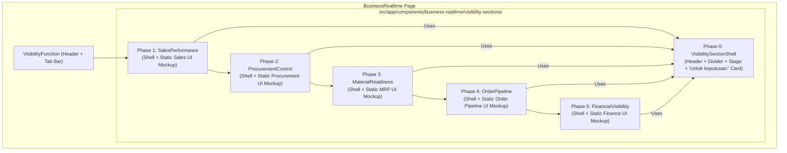

# PRD: Business Realtime — Visibility Sections Architecture & Sequential Execution Plan

## 1. Context & Execution Philosophy

Directly beneath [`visibility-function.html`](src/app/components/business-realtime/visibility-function/visibility-function.html), we are introducing **5 functional showcase sections** inside [`src/app/components/business-realtime/visibility-sections/`](src/app/components/business-realtime):

1. **Sales Performance** (`sales-performance`)
2. **Procurement Control** (`procurement-control`)
3. **Material Readiness** (`material-readiness`)
4. **Order Pipeline** (`order-pipeline`)
5. **Financial Visibility** (`financial-visibility`)

### Core Execution Strategy
1. **Sequential Domain-by-Domain Rollout:** Instead of scaffolding empty placeholders for all 5 at once, we will build and ship them **one domain component at a time** in strict order:
   `Foundation Shell` $\rightarrow$ `1. Sales Performance` $\rightarrow$ `2. Procurement Control` $\rightarrow$ `3. Material Readiness` $\rightarrow$ `4. Order Pipeline` $\rightarrow$ `5. Financial Visibility`.
2. **Static Frontend UI Mockup First (Zero Interactive Logic):**
   - Each domain component will be built with its **complete visual Frontend UI Mockup** (pure HTML, Tailwind CSS, and static SVG charts/bars/tables) matching the Figma design 1:1.
   - **No interactive logic** (no dropdown state, chart view switching, hover tooltips, or dynamic dataset recalculations) will be added during this phase. Interactive behavior will be layered on in a dedicated future pass once the static UI of the sections is finalized.

---

## 2. Shared vs. Domain-Specific Architecture

### 2.1. Shared Outer Frame: `VisibilitySectionShell` (`<ng-content>`)
All 5 sections share the exact same outer presentation layout:
- **Outer Rounded Card Container** (`rounded-3xl bg-white shadow-[0_8px_30px_rgba(35,36,78,0.08)] overflow-hidden`)
- **Top White Header Block:**
  - Centered Heading (`<h3>`, e.g., *"Lihat Arah Penjualan Sejak Awal"*)
  - Centered Blue Horizontal Divider Line (`h-px bg-[#365AD2]`)
  - Centered Description Paragraph
- **Bottom Colored Stage (`bg-[#F9CEC8]` or custom stage class):**
  - **Left/Main Column:** Projects the domain component's **Static Frontend UI Mockup** via `<ng-content />`.
  - **Right Column:** Renders the **"Untuk keputusan:" Card** (top icon/thumbnail box + bold `"Untuk keputusan:"` label + decision body text).

### 2.2. Shared ERP Window Chrome (Optional Sub-Shell or Standardized Layout)
Looking at the UI mockup window inside the pink stage, notice that the mockup itself has a consistent **SOFICloud ERP Window Frame**:
- **Window Top Bar:** Cart/ERP icon + `| Dashboard` on the left, `<Module Title> (PT INFORSYS INDONESIA )` in the center-left, and user avatar `A` + chevron on the right.
- **Left Sidebar Navigation (5 items matching the 5 sections):**
  - `Procurement`
  - `Sales`
  - `MRP`
  - `Finance`
  - `Order Pipeline`
  *(With the current section's sidebar item highlighted in soft blue `bg-[#E8F0FE]`)*
- **Top-Right Status Pills:** `Admin` | `Thursday, 28 Jul 2026` | `09:54:25 AM`
- **Inner Dashboard Canvas:** The domain-specific cards and charts.



---

## 3. Target Directory Structure

```text
src/app/components/business-realtime/
├── hero/
├── visibility-function/
└── visibility-sections/
    ├── visibility-section-shell/          # Built in Phase 0
    │   ├── visibility-section-shell.html
    │   ├── visibility-section-shell.spec.ts
    │   └── visibility-section-shell.ts
    ├── sales-performance/                 # Built in Phase 1
    │   ├── sales-performance.html
    │   ├── sales-performance.spec.ts
    │   └── sales-performance.ts
    ├── procurement-control/               # Built in Phase 2
    │   ├── procurement-control.html
    │   ├── procurement-control.spec.ts
    │   └── procurement-control.ts
    ├── material-readiness/                # Built in Phase 3
    │   ├── material-readiness.html
    │   ├── material-readiness.spec.ts
    │   └── material-readiness.ts
    ├── order-pipeline/                    # Built in Phase 4
    │   ├── order-pipeline.html
    │   ├── order-pipeline.spec.ts
    │   └── order-pipeline.ts
    └── financial-visibility/              # Built in Phase 5
        ├── financial-visibility.html
        ├── financial-visibility.spec.ts
        └── financial-visibility.ts
```

---

## 4. Step-by-Step Execution Plan

### Phase 0: Foundation (`VisibilitySectionShell` & Page Wiring)
Before building the first domain component, set up the shared wrapper and clean up the temporary placeholder in [`visibility-function.html`](src/app/components/business-realtime/visibility-function/visibility-function.html#L73-L143).

- **Step 0.1 — Create `VisibilitySectionShell` (`src/app/components/business-realtime/visibility-sections/visibility-section-shell/`):**
  - Define signal inputs:
    - `sectionId = input.required<string>()`
    - `titleKey = input.required<string>()`
    - `descriptionKey = input.required<string>()`
    - `decisionTextKey = input.required<string>()`
    - `decisionLabelKey = input<string>('BUSINESS_REALTIME.VISIBILITY_SECTIONS.COMMON.DECISION_LABEL')`
    - `decisionIconSrc = input<string | undefined>(undefined)`
    - `stageBgClass = input<string>('bg-[#F9CEC8]')`
  - Build the responsive HTML template:
    - White top header (`<h3>` title, `#365AD2` horizontal line, description `<p>`).
    - Colored bottom stage with a responsive grid: `<ng-content />` on the left (mockup slot) and the **"Untuk keputusan:"** white card on the right.
- **Step 0.2 — Initialize Base i18n Namespace (`public/i18n/{id,en,ja,ko,zh}.json`):**
  - Add `BUSINESS_REALTIME.VISIBILITY_SECTIONS.COMMON` (`DECISION_LABEL: "Untuk keputusan:"`, plus common ERP mockup frame labels like `DASHBOARD`, `ADMIN`, sidebar items `PROCUREMENT`, `SALES`, `MRP`, `FINANCE`, `ORDER_PIPELINE`).
- **Step 0.3 — Clean Up `VisibilityFunction`:**
  - Remove the temporary static image `tabpanel` placeholder from [`visibility-function.html`](src/app/components/business-realtime/visibility-function/visibility-function.html#L73-L143) so the domain sections can be rendered cleanly right below the tab bar.

---

### Phase 1: Domain Component 1 — `SalesPerformance` (`sales-performance`)
Build the complete static Frontend UI for **Sales Performance** (matching the provided design reference) with zero interactive logic.

- **Step 1.1 — Add Sales Performance i18n Keys (`public/i18n/*.json`):**
  - `TITLE`: *"Lihat Arah Penjualan Sejak Awal"*
  - `DESCRIPTION`: *"Nilai open sales order memperlihatkan pesanan yang masih berjalan. Jumlah pelanggan aktif memberi konteks terhadap basis penjualan, sementara grafik bulanan membantu membandingkan tren tahun berjalan dengan periode sebelumnya."*
  - `DECISION_TEXT`: *"Pantau perubahan pipeline dan selidiki bulan ketika kinerja mulai melemah"*
  - Mockup static labels (`Sales (PT INFORSYS INDONESIA )`, `OPEN SO VALUE (IDR)`, `NUMBER OF ACTIVE CUSTOMER (IDR)`, `SALES ANALYSIS (IDR)`, `SELECT VIEW CHART`, `LINE CHART`).
- **Step 1.2 — Scaffold `SalesPerformance` Component (`src/app/components/business-realtime/visibility-sections/sales-performance/`):**
  - Import `VisibilitySectionShell` and `TranslatePipe`.
  - Wrap the template in `<app-visibility-section-shell sectionId="sales-performance" ...>`.
- **Step 1.3 — Build Static ERP Window Chrome inside `sales-performance.html`:**
  - **Top Bar:** Cart icon + `| Dashboard`, title `Sales (PT INFORSYS INDONESIA )`, right avatar `A` badge with chevron icon.
  - **Left Sidebar:** Static list of 5 items (`Procurement`, `Sales`, `MRP`, `Finance`, `Order Pipeline`) with `Sales` styled as the active pill (`bg-[#E5EDFF] text-[#23244E] font-semibold`).
  - **Subheader Meta Pills:** Right-aligned static pills for `Admin`, `Thursday, 28 Jul 2026`, and `09:54:25 AM`.
- **Step 1.4 — Build Static Sales Dashboard Cards & SVG Charts (Frontend UI Only):**
  - **Card 1 (Top-Left): `OPEN SO VALUE (IDR)`**
    - Header with title + static 3-dot vertical icon.
    - Static vertical bar chart (`0`, `200 M`, `400 M`, `600 M` Y-axis gridlines; 6 bars for `Apr 2026`–`Sep 2026` colored in soft coral/salmon for Apr–Jun and blue shades for Jul–Sep).
  - **Card 2 (Top-Right): `NUMBER OF ACTIVE CUSTOMER (IDR)`**
    - Header with title + static 3-dot vertical icon.
    - Static vertical bar chart (`0` to `60` Y-axis gridlines; 6 bars for `Apr 2026`–`Sep 2026` in matching coral/blue palette).
  - **Card 3 (Bottom-Center): `SALES ANALYSIS (IDR)`**
    - Header with title, static `SELECT VIEW CHART` + `LINE CHART v` badge, legend (`2026` blue pill, `2025` coral pill), and static 3-dot icon.
    - Static SVG dual smooth line chart (`0` to `600 M` Y-axis gridlines, 12-month X-axis grid, blue `2026` curve + coral `2025` curve with static data point circles).
- **Step 1.5 — Mount & Verify Phase 1:**
  - Render `<app-sales-performance />` in [`business-realtime.html`](src/app/pages/business-realtime/business-realtime.html).
  - Write unit test in `sales-performance.spec.ts` verifying component render and AXE accessibility compliance.

---

### Phase 2: Domain Component 2 — `ProcurementControl` (`procurement-control`)
Execute after Phase 1 is complete and verified.

- **Step 2.1 — Add Procurement Control i18n Keys (`public/i18n/*.json`):**
  - Add `BUSINESS_REALTIME.VISIBILITY_SECTIONS.PROCUREMENT_CONTROL` (`TITLE`, `DESCRIPTION`, `DECISION_TEXT`, and static mockup labels from the Procurement design).
- **Step 2.2 — Scaffold `ProcurementControl` Component (`src/app/components/business-realtime/visibility-sections/procurement-control/`):**
  - Wrap template in `<app-visibility-section-shell sectionId="procurement-control" ...>`.
- **Step 2.3 — Build Static ERP Window Chrome:**
  - Set window title to `Procurement (PT INFORSYS INDONESIA )` and highlight `Procurement` in the 5-item left sidebar.
- **Step 2.4 — Build Static Procurement Dashboard UI Mockup (Frontend UI Only):**
  - Implement the static cards, tables, or SVG charts specific to the Procurement Control mockup design with zero interactive logic.
- **Step 2.5 — Mount & Verify Phase 2:**
  - Register `<app-procurement-control />` in [`business-realtime.html`](src/app/pages/business-realtime/business-realtime.html) and add unit tests in `procurement-control.spec.ts`.

---

### Phase 3: Domain Component 3 — `MaterialReadiness` (`material-readiness`)
Execute after Phase 2 is complete and verified.

- **Step 3.1 — Add Material Readiness i18n Keys (`public/i18n/*.json`):**
  - Add `BUSINESS_REALTIME.VISIBILITY_SECTIONS.MATERIAL_READINESS` (`TITLE`, `DESCRIPTION`, `DECISION_TEXT`, and static mockup labels from the Material Readiness / MRP design).
- **Step 3.2 — Scaffold `MaterialReadiness` Component (`src/app/components/business-realtime/visibility-sections/material-readiness/`):**
  - Wrap template in `<app-visibility-section-shell sectionId="material-readiness" ...>`.
- **Step 3.3 — Build Static ERP Window Chrome:**
  - Set window title to `MRP (PT INFORSYS INDONESIA )` and highlight `MRP` in the 5-item left sidebar.
- **Step 3.4 — Build Static Material Readiness Dashboard UI Mockup (Frontend UI Only):**
  - Implement the static cards, indicators, and SVG charts specific to the Material Readiness mockup design with zero interactive logic.
- **Step 3.5 — Mount & Verify Phase 3:**
  - Register `<app-material-readiness />` in [`business-realtime.html`](src/app/pages/business-realtime/business-realtime.html) and add unit tests in `material-readiness.spec.ts`.

---

### Phase 4: Domain Component 4 — `OrderPipeline` (`order-pipeline`)
Execute after Phase 3 is complete and verified.

- **Step 4.1 — Add Order Pipeline i18n Keys (`public/i18n/*.json`):**
  - Add `BUSINESS_REALTIME.VISIBILITY_SECTIONS.ORDER_PIPELINE` (`TITLE`, `DESCRIPTION`, `DECISION_TEXT`, and static mockup labels from the Order Pipeline design).
- **Step 4.2 — Scaffold `OrderPipeline` Component (`src/app/components/business-realtime/visibility-sections/order-pipeline/`):**
  - Wrap template in `<app-visibility-section-shell sectionId="order-pipeline" ...>`.
- **Step 4.3 — Build Static ERP Window Chrome:**
  - Set window title to `Order Pipeline (PT INFORSYS INDONESIA )` and highlight `Order Pipeline` in the 5-item left sidebar.
- **Step 4.4 — Build Static Order Pipeline Dashboard UI Mockup (Frontend UI Only):**
  - Implement the static pipeline stages, cards, and SVG charts specific to the Order Pipeline mockup design with zero interactive logic.
- **Step 4.5 — Mount & Verify Phase 4:**
  - Register `<app-order-pipeline />` in [`business-realtime.html`](src/app/pages/business-realtime/business-realtime.html) and add unit tests in `order-pipeline.spec.ts`.

---

### Phase 5: Domain Component 5 — `FinancialVisibility` (`financial-visibility`)
Execute after Phase 4 is complete and verified.

- **Step 5.1 — Add Financial Visibility i18n Keys (`public/i18n/*.json`):**
  - Add `BUSINESS_REALTIME.VISIBILITY_SECTIONS.FINANCIAL_VISIBILITY` (`TITLE`, `DESCRIPTION`, `DECISION_TEXT`, and static mockup labels from the Financial Visibility design).
- **Step 5.2 — Scaffold `FinancialVisibility` Component (`src/app/components/business-realtime/visibility-sections/financial-visibility/`):**
  - Wrap template in `<app-visibility-section-shell sectionId="financial-visibility" ...>`.
- **Step 5.3 — Build Static ERP Window Chrome:**
  - Set window title to `Finance (PT INFORSYS INDONESIA )` and highlight `Finance` in the 5-item left sidebar.
- **Step 5.4 — Build Static Financial Visibility Dashboard UI Mockup (Frontend UI Only):**
  - Implement the static financial widgets, cash/AR/AP cards, and SVG charts specific to the Financial Visibility mockup design with zero interactive logic.
- **Step 5.5 — Mount & Verify Phase 5:**
  - Register `<app-financial-visibility />` in [`business-realtime.html`](src/app/pages/business-realtime/business-realtime.html) and add unit tests in `financial-visibility.spec.ts`.

---

### Phase 6 (Future Pass): Interactive Mockup Logic & Tab Synchronization
Once all 5 static frontend UI mockups are visually complete and approved:
- Wire interactive chart toggles (e.g., switching `LINE CHART` / `BAR CHART`), hover tooltips, and interactive filters per domain component.
- Finalize tab bar interaction between [`VisibilityFunction`](src/app/components/business-realtime/visibility-function/visibility-function.ts) and the 5 showcase sections (smooth scroll / scroll-spy or tab switching).

---

## 5. Technical & Accessibility Guardrails (Per `AGENTS.md`)

1. **Angular v22 Conventions:**
   - Do **not** set `standalone: true` or `changeDetection: ChangeDetectionStrategy.OnPush` in `@Component` decorators (both are defaults).
   - Use `input()` / `input.required()` functions instead of `@Input()`.
   - Use native control flow (`@if`, `@for`, `@switch`) and `[class]` / `[style]` bindings (no `ngClass` / `ngStyle`).
2. **Static UI Mockup Accessibility (WCAG AA & AXE):**
   - Decorative SVG charts in the static UI phase must include `aria-hidden="true"` or an accessible `role="img"` with `aria-label` so screen readers and AXE checks pass cleanly.
   - Ensure text contrast inside the mockup cards (e.g., axis labels, badges, and sidebar items) meets WCAG AA contrast minimums.
