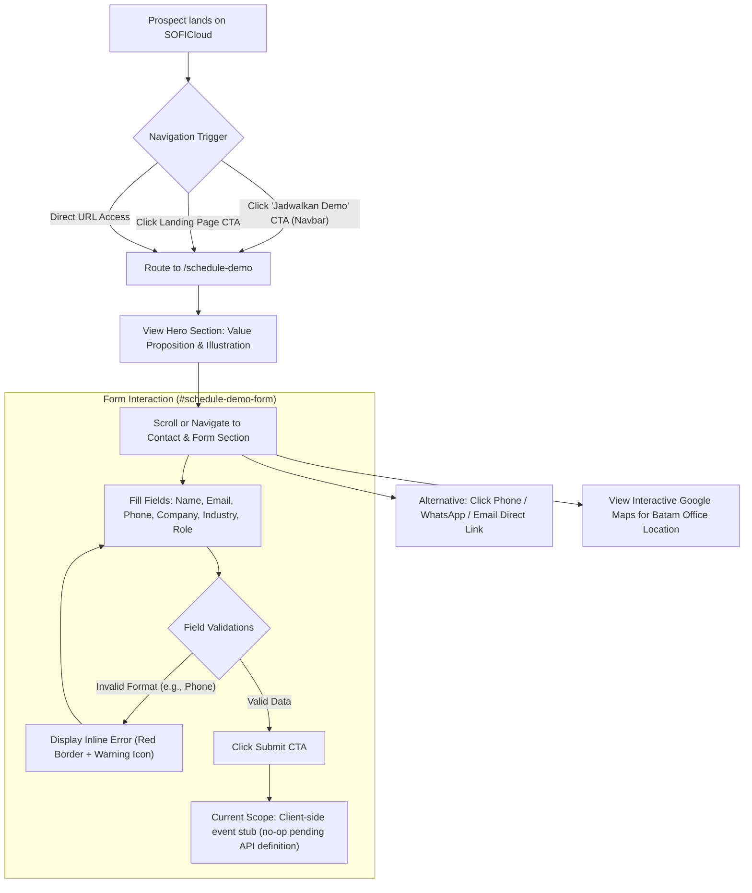
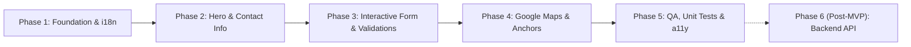

# Product Requirements Document (PRD)
## Feature: Schedule Demo Page (`/schedule-demo`)

- **Document Version**: 1.0.0
- **Status**: Draft / Ready for Review
- **Product**: SOFICloud ERP
- **Author**: Pair Programming Agent
- **Target Release**: Q4 2026 / Next Sprint

---

## 1. Executive Summary & Objective

The **Schedule Demo** page (`/schedule-demo`) is a dedicated landing experience designed for enterprise B2B prospects evaluating SOFICloud ERP. The primary goal is to provide prospective enterprise clients—such as manufacturing, trading, construction, and service companies—with a frictionless, transparent, and trustworthy channel to request a tailored demonstration and get in direct contact with PT Inforsys Indonesia.

### Core Objectives:
1. **Increase Lead Conversion**: Deliver a modern, high-trust, responsive form experience that captures critical qualifying lead data (company, industry, role, contact).
2. **Local Office Presence & Multi-channel Reach**: Showcase PT Inforsys Indonesia’s verified Batam headquarters, operational hours, direct WhatsApp, and interactive Google Maps embed.
3. **Seamless Brand Continuity**: Integrate seamlessly with existing SOFICloud navigation, localized language toggle (ID, EN, ZH, JA, KO), and global design tokens.

---

## 2. User Journey & Navigation Flow



### Navbar Integration Behavior:
- When a user is already on `/schedule-demo`, clicking the top navbar **"Jadwalkan Demo"** button will **smooth-scroll directly to the form section (`#schedule-demo-form`)** rather than triggering a redundant route transition.

---

## 3. Page Structure & Section Breakdown

The page is structured sequentially into three main content blocks between the global `Navbar` and `Footer`:

```
+-----------------------------------------------------------+
|                      Global Navbar                        |
+-----------------------------------------------------------+
| [Hero Section]                                            |
|  - Phone & notification graphic (Left)                    |
|  - Value proposition headline & description (Right)       |
+-----------------------------------------------------------+
| [Contact & Form Section (#schedule-demo-form)]            |
|  +-----------------------------+------------------------+ |
|  | PT Inforsys Info Card       | Lead Capture Form      | |
|  | - Phone, WA, Email          | - 2-col inputs         | |
|  | - Hours, Batam Address      | - Industry dropdown    | |
|  +-----------------------------+------------------------+ |
+-----------------------------------------------------------+
| [Google Maps Location Section]                            |
|  - Interactive map embed centered on Batam office         |
+-----------------------------------------------------------+
|                      Global Footer                        |
+-----------------------------------------------------------+
```

---

## 4. Detailed Component Specifications

### 4.1 Hero Section
- **Visual Design**:
  - Encapsulated within a large rounded white card (`rounded-3xl` / `rounded-[32px]`) positioned against a soft gradient canvas (`bg-linear-to-b from-[#eaf2ff] via-[#f3f7fd] to-white`).
  - Ample responsive padding (`p-6 sm:p-10 lg:p-16`).
- **Left Column — Modern Hero Illustration**:
  - Modern isometric/flat illustration featuring:
    - Stylized blue smartphone displaying an ERP user card and list layout.
    - Two coral/pink chat bubbles with placeholder message lines.
    - Red notification bell icon with dynamic wave rings on top-right of the phone.
    - Dashed circular trajectory ring framing the composition.
  - Image optimization: Rendered via `` with explicit dimensions (`width`, `height`, `priority="true"`) to prevent Cumulative Layout Shift (CLS).
- **Right Column — Hero Copy**:
  - **Headline (H1)**:
    - Text (ID): *"Mari Temukan Solusi Untuk Bisnis Anda"*
    - Text (EN): *"Let's Find the Right Solution for Your Business"*
    - Typography: Bold display font (`font-dm-sans`), text color `#182849` (Navy), sizes: `text-3xl sm:text-4xl lg:text-5xl`, tracking tight.
  - **Subheadline**:
    - Text (ID): *"Kenali fitur dan kemampuan SOFICloud melalui demo yang disesuaikan dengan kebutuhan perusahaan Anda."*
    - Text (EN): *"Discover SOFICloud features and capabilities through a tailored demo built around your company's needs."*
    - Typography: Neutral gray (`text-slate-600`), sizes: `text-base sm:text-lg`, line height relaxed.

---

### 4.2 Contact & Form Section (`#schedule-demo-form`)

A unified container card split into two distinct panels:

#### A. Left Panel — PT Inforsys Indonesia Information
- **Styling**: Solid brand blue background (`bg-[#1D44EB]` or `bg-[#0D52D6]`), rounded left corners on desktop, white typography.
- **Header**:
  - Text: `"PT Inforsys Indonesia"`
  - Typography: `font-dm-sans font-bold text-xl sm:text-2xl text-white`.
- **Contact Details & Dividers**:
  Each item features a subtle label in muted light blue/white-80 and a bold white value, separated by a thin translucent horizontal divider (`border-b border-white/20 pb-4 mb-4`):
  1. **Nomor Telepon**:
     - Label: `"Nomor Telepon"`
     - Value: `+62 778 416 0250`
     - Action: Clickable link (`href="tel:+627784160250"`).
  2. **WhatsApp**:
     - Label: `"WhatsApp"`
     - Value: `+62 811 7774 744`
     - Action: Clickable link (`href="https://wa.me/628117774744" target="_blank"`).
  3. **Email**:
     - Label: `"Email"`
     - Value: `hello@inforsys.co.id`
     - Action: Clickable link (`href="mailto:hello@inforsys.co.id"`).
  4. **Jam Operasional**:
     - Label: `"Jam Operasional"`
     - Value: `"Senin – Jumat"`<br/>`"08.00–17.00 WIB"`
  5. **Alamat Kantor**:
     - Label: `"Alamat Kantor"`
     - Value: `"Orchard Park Blok C No.18"`<br/>`"Batam, Kepulauan Riau 29464,"`<br/>`"Indonesia"`

---

#### B. Right Panel — Lead Capture Form
- **Styling**: White background, generous internal padding (`p-6 sm:p-10`), rounded right corners on desktop.
- **Form Heading**:
  - Title (H2): `"Hubungi kami"` (font-bold, `#182849`, `text-2xl sm:text-3xl`).
  - Subtitle: `"Cukup isi formulir di bawah ini dan kami akan segera menghubungi Anda kembali."` (`text-slate-600`, `text-sm sm:text-base`).
- **Form Layout**: 2-column responsive CSS grid (`grid grid-cols-1 sm:grid-cols-2 gap-4 sm:gap-6`).
- **Input Fields & Validation Specification**:

| # | Field Name | HTML Input Type | Icon (Left) | Placeholder | Validation Rules | Error State Specification |
|---|------------|-----------------|-------------|-------------|------------------|---------------------------|
| 1 | **Nama** (Full Name) | `text` | User icon | `"Nama"` | Required, min 2 characters | Red outline, error label: *"Nama wajib diisi"* |
| 2 | **Email** | `email` | Envelope / Mail icon | `"Email"` | Required, valid email pattern (`^[a-zA-Z0-9._%+-]+@[a-zA-Z0-9.-]+\.[a-zA-Z]{2,}$`) | Red outline, error label: *"Format email tidak valid"* |
| 3 | **Nomor Telepon** | `tel` | Phone receiver icon | `"Nomor Telepon"` | Required, Indonesian/international format `^(\+62\|62\|0)[0-9]{8,13}$` | **Figma Reference State**: Red border (`border-red-500`), red alert circle icon + text: *"Format nomor telepon tidak valid"* |
| 4 | **Nama Perusahaan** | `text` | Building / Company icon | `"Nama Perusahaan"` | Required, min 2 characters | Red outline, error label: *"Nama perusahaan wajib diisi"* |
| 5 | **Industri** (Sector) | Custom Select Dropdown | Factory / Building icon | `"Pilih Industri"` | Required (must select one option) | Red outline, error label: *"Pilih industri perusahaan Anda"* |
| 6 | **Posisi Anda** (Job Title) | `text` | Badge / Profile icon | `"Posisi Anda"` | Required, min 2 characters | Red outline, error label: *"Posisi wajib diisi"* |

- **Industry Dropdown Options** (Exact Figma Values):
  1. `Manufaktur` (Manufacturing)
  2. `Perdagangan & Industri` (Trading & Industry)
  3. `Konstruksi` (Construction)
  4. `Layanan` (Services)
  5. `Lainnya` (Others)
- **Dropdown Interactive UX**:
  - Trigger displays current selection or placeholder, with factory icon on the left and chevron-down on the right.
  - Dropdown panel opens with smooth elevation, shadow, and border.
  - Options display active background highlight (`bg-blue-50 text-blue-600 font-medium`) for the currently selected item.
  - Keyboard accessible: `Enter`/`Space` to open/select, `ArrowUp`/`ArrowDown` to navigate, `Escape` to close.
  - Click-outside dismiss listener.
- **Submit Button**:
  - Text: `"Jadwalkan Demo"`
  - Button styling: Brand blue gradient (`bg-linear-to-r from-[#1d44eb] via-[#2563eb] to-[#3b82f6]`), rounded-xl, font-semibold, white text.
  - Hover / Focus / Active micro-interactions matching site design system.
  - **Submission Handling (Scope Note)**:
    - *Per current decision*: Backend API endpoint and post-submission navigation are currently unassigned/unknown.
    - *Behavior*: Validates form fields on click; prevents browser reload; fires a stubbed client-side handler (`console.info('Demo request submitted:', formData)`) with no backend mutation or page redirect until defined in future phases.

---

### 4.3 Google Maps Location Section
- **Visual Design**:
  - Self-contained rounded card (`rounded-2xl` / `rounded-3xl` with subtle border/shadow) sitting on the page gradient canvas.
  - Interactive Google Maps embed focused on **PT Inforsys Indonesia**.
- **Location Coordinates & Details**:
  - Place: PT Inforsys Indonesia
  - Location: Orchard Park Batam, Orchard Boulevard, Belian, Batam Kota, Batam City, Riau Islands 29464.
- **Technical Attributes**:
  - Standard Google Maps controls (Layers, Satellite, Zoom `+`/`-`, Street View Pegman).
  - Responsive height: `min-h-[360px] sm:min-h-[420px] lg:min-h-[480px] w-full`.
  - Performance: `loading="lazy"` attribute on iframe.
  - Accessibility: `title="Peta Lokasi Kantor PT Inforsys Indonesia"`.

---

## 5. Technical Architecture & Coding Standards

In compliance with the project’s [`AGENTS.md`](file:///home/rickymarove/soficloud-v1-2026/AGENTS.md) guidelines:

### 5.1 Angular 22 Architectural Rules
- **Standalone Components**: Default standalone mode (do NOT write `standalone: true`).
- **Change Detection**: Default `OnPush` (do NOT write `changeDetection: ChangeDetectionStrategy.OnPush`).
- **State Management**:
  - Utilize Angular Signals (`signal()`, `computed()`) for local UI states (e.g., `isDropdownOpen = signal<boolean>(false)`).
  - No `mutate` calls on signals; use `update` or `set`.
- **Form Architecture**:
  - Utilize Reactive Forms (`ReactiveFormsModule`) or Signal Forms (`@angular/forms/signals`) with typed controls.
  - Bind errors cleanly with `@if (phoneControl.invalid && (phoneControl.dirty || phoneControl.touched))` native control flow.
- **Bindings**:
  - Use `class` bindings instead of `ngClass`.
  - Use `style` bindings instead of `ngStyle`.
  - Use `inject()` for dependency injection instead of constructor injection.
- **Component Decomposition**:
  - Page Component: `ScheduleDemo` (`src/app/pages/schedule-demo/schedule-demo.ts`)
  - Sub-components (optional/modular):
    - `ScheduleDemoHero`
    - `ScheduleDemoForm`
    - `ScheduleDemoMap`

### 5.2 Routing Configuration
Lazy-loaded route configured in `src/app/systems/routes/app.routes.ts`:
```typescript
{
  path: 'schedule-demo',
  loadComponent: () =>
    import('../../pages/schedule-demo/schedule-demo').then((m) => m.ScheduleDemo),
}
```

---

## 6. Internationalization (i18n) Tree

All textual content must be stored in translation files (`public/i18n/*.json`) under a dedicated `SCHEDULE_DEMO` namespace.

```json
{
  "SCHEDULE_DEMO": {
    "PAGE_TITLE": "Jadwalkan Demo - SOFICloud ERP",
    "HERO": {
      "TITLE": "Mari Temukan Solusi Untuk Bisnis Anda",
      "SUBTITLE": "Kenali fitur dan kemampuan SOFICloud melalui demo yang disesuaikan dengan kebutuhan perusahaan Anda."
    },
    "CONTACT_INFO": {
      "COMPANY_NAME": "PT Inforsys Indonesia",
      "PHONE_LABEL": "Nomor Telepon",
      "PHONE_VALUE": "+62 778 416 0250",
      "WHATSAPP_LABEL": "WhatsApp",
      "WHATSAPP_VALUE": "+62 811 7774 744",
      "EMAIL_LABEL": "Email",
      "EMAIL_VALUE": "hello@inforsys.co.id",
      "HOURS_LABEL": "Jam Operasional",
      "HOURS_DAYS": "Senin – Jumat",
      "HOURS_TIME": "08.00–17.00 WIB",
      "ADDRESS_LABEL": "Alamat Kantor",
      "ADDRESS_LINE1": "Orchard Park Blok C No.18",
      "ADDRESS_LINE2": "Batam, Kepulauan Riau 29464,",
      "ADDRESS_LINE3": "Indonesia"
    },
    "FORM": {
      "TITLE": "Hubungi kami",
      "SUBTITLE": "Cukup isi formulir di bawah ini dan kami akan segera menghubungi Anda kembali.",
      "FIELDS": {
        "NAME_PLACEHOLDER": "Nama",
        "EMAIL_PLACEHOLDER": "Email",
        "PHONE_PLACEHOLDER": "Nomor Telepon",
        "COMPANY_PLACEHOLDER": "Nama Perusahaan",
        "INDUSTRY_PLACEHOLDER": "Pilih Industri",
        "POSITION_PLACEHOLDER": "Posisi Anda"
      },
      "INDUSTRIES": {
        "MANUFACTURING": "Manufaktur",
        "TRADING": "Perdagangan & Industri",
        "CONSTRUCTION": "Konstruksi",
        "SERVICES": "Layanan",
        "OTHERS": "Lainnya"
      },
      "ERRORS": {
        "NAME_REQUIRED": "Nama wajib diisi",
        "EMAIL_INVALID": "Format email tidak valid",
        "PHONE_INVALID": "Format nomor telepon tidak valid",
        "COMPANY_REQUIRED": "Nama perusahaan wajib diisi",
        "INDUSTRY_REQUIRED": "Pilih industri perusahaan Anda",
        "POSITION_REQUIRED": "Posisi wajib diisi"
      },
      "SUBMIT_BUTTON": "Jadwalkan Demo"
    },
    "MAP": {
      "TITLE": "Peta Lokasi Kantor PT Inforsys Indonesia",
      "ARIA_LABEL": "Peta Google Maps menunjukkan lokasi kantor PT Inforsys Indonesia di Batam"
    }
  }
}
```

---

## 7. Accessibility (WCAG 2.1 AA) & Performance Guidelines

1. **Form Labels & Error Association**:
   - Each input must have an accessible label via `<label for="inputId">` (visually hidden or visually positioned).
   - In error states, the input must set `aria-invalid="true"` and `aria-describedby="[fieldId]-error"` pointing to the error message text.
2. **Keyboard Navigation for Custom Dropdown**:
   - Implements WAI-ARIA Listbox Pattern (`role="combobox"`, `role="listbox"`, `role="option"`, `aria-expanded`).
   - Supports keyboard keys: `Tab`, `ArrowDown`, `ArrowUp`, `Enter`, `Escape`.
3. **Contrast Ratios**:
   - White text on primary blue (`#1D44EB`): Contrast ratio exceeds 7.5:1 (passes AAA).
   - Error text on white: Red `#EF4444` / `#DC2626` has a contrast ratio >= 4.5:1 against white.
4. **Performance & Core Web Vitals**:
   - Hero phone illustration loaded using Angular `NgOptimizedImage` with `priority` attribute to optimize LCP.
   - Google Maps iframe loaded asynchronously with `loading="lazy"`.

---

## 8. Phases of Implementation

To ensure high engineering velocity, component modularity, and seamless verification, the implementation of the Schedule Demo page is divided into structured, sequential phases:



### Phase 1: Foundation, Routing & i18n Setup
- [ ] **Routing**: Add `/schedule-demo` lazy-loaded route in [`src/app/systems/routes/app.routes.ts`](file:///home/rickymarove/soficloud-v1-2026/src/app/systems/routes/app.routes.ts).
- [ ] **Page Scaffold**: Generate standalone page component `ScheduleDemo` in `src/app/pages/schedule-demo/` with template, stylesheet (Tailwind), and unit test spec.
- [ ] **Translation Dictionaries**: Populate the `SCHEDULE_DEMO` namespace in `public/i18n/id.json`, `en.json`, `zh.json`, `ja.json`, and `ko.json`.
- [ ] **Navbar Integration**: Update [`Navbar`](file:///home/rickymarove/soficloud-v1-2026/src/app/components/shared/navbar/navbar.ts) logic so that when the current route is `/schedule-demo`, clicking the "Jadwalkan Demo" CTA triggers smooth scrolling to `#schedule-demo-form` instead of route redirection.

### Phase 2: Static Layout, Hero Section & Company Info Panel
- [ ] **Outer Page Canvas**: Implement gradient background canvas (`from-[#eaf2ff] via-[#f3f7fd] to-white`) and container width constraints.
- [ ] **Hero Section**:
  - Build large rounded white card (`rounded-3xl` / `rounded-[32px]`).
  - Add phone illustration graphic with notification bell and message speech bubbles using `NgOptimizedImage`.
  - Implement responsive H1 headline (*"Mari Temukan Solusi Untuk Bisnis Anda"*) and subheadline.
- [ ] **Left Panel (PT Inforsys Indonesia Info)**:
  - Implement solid primary blue background card (`bg-[#1D44EB]`).
  - Render company title and verified contact info (phone, WhatsApp, email, hours, Batam address).
  - Add thin translucent dividers (`border-white/20`) between items.
  - Wire interactive click-to-call (`tel:`), WhatsApp (`https://wa.me/`), and email (`mailto:`) links.

### Phase 3: Interactive Form Component & Validation Engine
- [ ] **Form State**: Set up typed Angular Reactive Form / Signal Form with validation schema.
- [ ] **Standard Inputs**: Render *Nama*, *Email*, *Nama Perusahaan*, and *Posisi Anda* with left SVG icons and floating/inline labels.
- [ ] **Phone Number Input with Validation**:
  - Implement regex validator for Indonesian / international phone numbers (`^(\+62|62|0)[0-9]{8,13}$`).
  - Implement Figma error visual state: red border (`border-red-500`), alert icon, and inline error message (*"Format nomor telepon tidak valid"*).
- [ ] **Custom Accessible Dropdown (Industri)**:
  - Render select button with factory icon and chevron toggle.
  - Populate 5 industry options (*Manufaktur*, *Perdagangan & Industri*, *Konstruksi*, *Layanan*, *Lainnya*).
  - Implement active background highlight for selected item.
  - Implement WAI-ARIA keyboard navigation (`ArrowUp`, `ArrowDown`, `Enter`, `Escape`) and click-outside dismissal.
- [ ] **Submission Button & Client Stub**:
  - Implement primary gradient CTA button (*"Jadwalkan Demo"*).
  - Implement form submission handler (prevent default, validate all fields, mark touched on invalid submit, log valid lead payload; no backend calls or page redirects in this phase).

### Phase 4: Google Maps Embed & Anchor Linking
- [ ] **Map Container**: Construct rounded card frame matching page rhythm.
- [ ] **Google Maps Embed**: Embed interactive iframe centered at PT Inforsys Indonesia Batam office with `loading="lazy"` and proper accessibility title.
- [ ] **Anchor Target**: Ensure `#schedule-demo-form` ID is bound to the form section for direct scrolling from navbar and external links.

### Phase 5: Verification, Unit Testing & Accessibility Audits
- [ ] **Unit Tests**: Write comprehensive test specs in `schedule-demo.spec.ts`:
  - Form initialization & control default values.
  - Field validation triggers & error message display.
  - Dropdown toggle, option selection, and keyboard event handling.
- [ ] **Accessibility (WCAG AA) Audit**:
  - Run AXE automated checks.
  - Verify `aria-invalid`, `aria-describedby`, label associations, and keyboard focus rings.
- [ ] **Cross-Device & Responsive Verification**:
  - Mobile (360px–480px): 1-column stacked layout, full-width inputs.
  - Tablet (768px–1024px): Proportional spacing.
  - Desktop (1280px+): 2-column side-by-side card grid.

### Phase 6: Post-MVP & Future Enhancements
- [ ] **Backend Lead Integration**: Connect form submission to backend API (`POST /api/schedule-demo`) or CRM webhook (e.g. HubSpot, Odoo, Email dispatch).
- [ ] **Post-Submission Confirmation**: Implement user feedback upon submission (inline success card, booking modal, or `/schedule-demo/thank-you` route).
- [ ] **Bot & Abuse Prevention**: Integrate Cloudflare Turnstile CAPTCHA widget.
- [ ] **Calendar Integration**: Option for prospects to pick a live date/time slot directly via Calendly or Google Calendar.

---

## 9. Open Items for Future Phases (Post-MVP)

1. **Backend Integration**: Implement real lead-capture endpoint (`POST /api/schedule-demo` or webhook connection to CRM / HubSpot / Odoo / Slack).
2. **Post-Submission Feedback**: Define UX for successful demo submission (e.g., inline success card, modal confirmation with calendar invite booking, or dedicated `/schedule-demo/thank-you` route).
3. **Spam & Bot Protection**: Add Cloudflare Turnstile CAPTCHA widget protection to the form.
